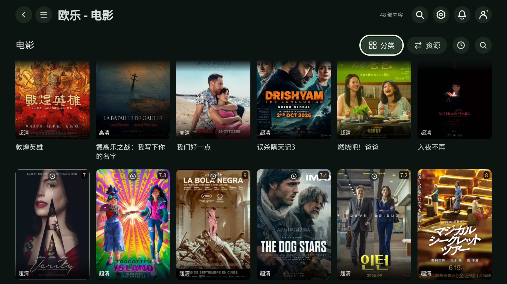
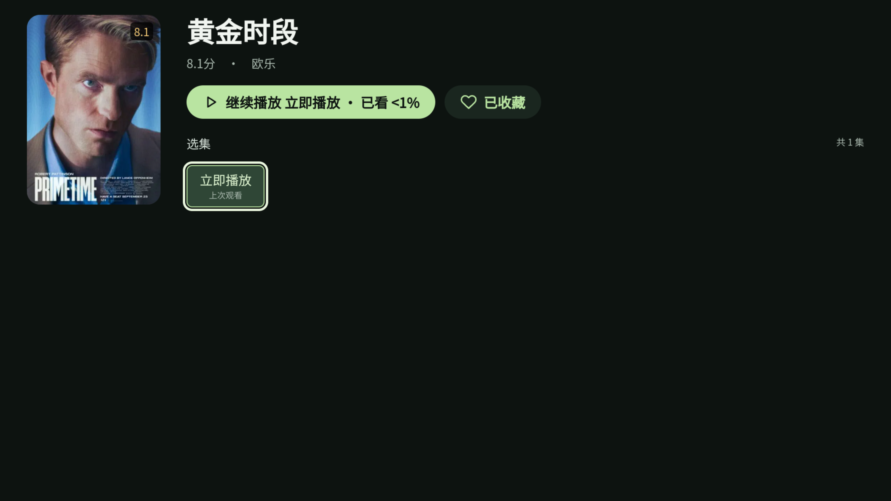
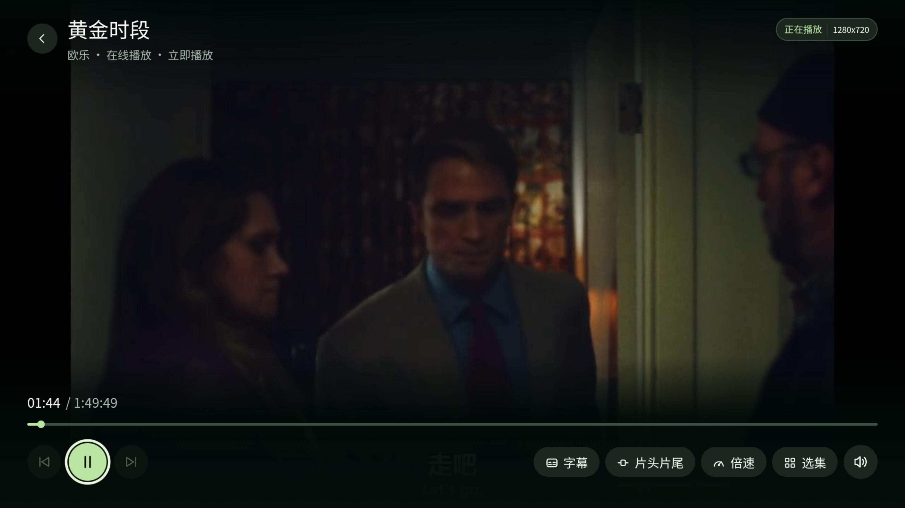

# 云映 TV

为 Android TV 和电视盒子设计的视频浏览与播放应用。使用遥控器浏览海报、筛选分类、搜索内容、选择集数，并接着上次的进度继续观看。

**[下载最新版本](https://github.com/aston314/yunying-tv-releases/releases/latest)** · **[查看所有版本](https://github.com/aston314/yunying-tv-releases/releases)**

## 应用功能

- **电视遥控器操作**：方向键移动、确认键选择、返回键退出当前页面，焦点高亮适合大屏观看。
- **自定义资源**：通过远程 JSON 配置添加资源，支持在电视上输入地址，也支持手机扫码输入。
- **浏览与搜索**：海报列表、资源分类、资源内搜索和全局搜索。
- **选集与续播**：查看影片详情，选择线路和集数，记住每集观看进度；卡片可显示收藏和播放状态。
- **播放器**：支持 Android Media3 和 HTML5 播放方式，提供进度拖动、上下集、倍速、字幕、片头片尾设置及分辨率显示。具体能力取决于视频和设备。
- **收藏与历史**：收藏喜欢的内容，查看和管理播放历史。
- **跨设备同步**：扫码登录后，可选择同步收藏、观看历史和播放进度；也可以关闭同步，继续使用本地记录。
- **界面个性化**：主题切换、动态背景，以及简体中文、繁體中文、English。

## 界面预览

以下为 Android TV 实际运行截图。截图中的内容随用户加载的资源配置变化。

### 海报浏览与分类



### 影片详情与续播



### 大屏播放器



## 安装与开始体验

1. 打开 [版本下载页](https://github.com/aston314/yunying-tv-releases/releases/latest)，在 Assets 中下载 `.apk` 文件。
2. 将 APK 安装到电视或盒子；如果系统询问安装来源权限，允许对应的安装来源。
3. 启动云映 TV，选择界面语言。
4. 进入设置中的资源配置，粘贴下面的体验配置地址；也可以用手机扫描应用显示的输入二维码，再在手机上粘贴。
5. 保存配置后，选择资源并开始浏览。

**体验资源配置：**

```text
https://code.aston.rocks/demo.json
```

[打开体验配置](https://code.aston.rocks/demo.json)

体验配置由远端维护，内容和可用性以实际返回为准。你也可以填写自己的兼容 JSON 资源配置。

## 设备与更新

- 最低 Android 6.0，APK 包含 `arm64-v8a`、`armeabi-v7a`、`x86_64`。
- 使用相同签名的新版本 APK 可直接覆盖安装，保留已有配置和本地记录。
- v0.1.44 及更早版本需要手动覆盖安装一次包含新更新入口的后续版本，才能使用此公开仓库的应用内更新。

## 测试反馈

遇到问题时，请提供设备型号、Android / WebView 版本、应用版本、使用的资源名称，以及复现步骤或截图，方便定位。
